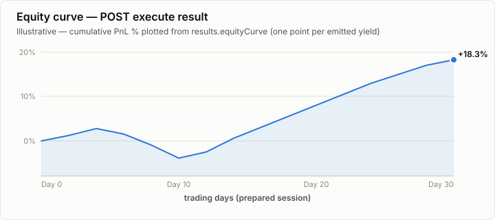

# Equity curves

An equity curve describes the account value through a backtest, or through a live paper account.
QTSurfer returns the same `EquityCurveResult` contract for a plain backtest, for a retained sweep
trial and for a live run's paper account, with different delivery rules:

- A plain backtest returns the curve inline in `results.equityCurve` and fixes its transform when
  the execution is submitted.
- A sweep row with a retained curve carries `equityCurve.url`. In the materialisation view
  (`?order=natural`) it can also include the curve inline; fetch its URL to choose a different
  transform at read time.
- A live run started with a `paper` block serves each account's curve on demand from
  `GET /live/{runId}/paper/equity`, which takes the same transform parameters on every read. See
  [Live paper accounts](#live-paper-accounts).

In a backtest or sweep curve the first point is an anchor at the backtest `from` timestamp with the
initial capital. Every later point is one sample per emitted yield. `equity` is account value (`initialCapital + cumulativePnl`),
not a percentage. To chart percentage return, normalize each value as
`(equity / initialEquity - 1) * 100`.



## Response shapes

`meta.outMode` determines which point representation is present.

### `ARRAY`

```json
{
  "points": [
    {"timestamp": 1700000000000, "equity": 100.0},
    {"timestamp": 1700000060000, "equity": 110.5},
    {"timestamp": 1700000120000, "equity": 90.25}
  ],
  "meta": {
    "inputPointCount": 3,
    "outputPointCount": 3,
    "resampled": false,
    "differential": false,
    "outMode": "ARRAY"
  }
}
```

### `SHORT`

`SHORT` removes repeated JSON property names by returning parallel arrays. Values at the same index
form one point.

```json
{
  "timestamps": [1700000000000, 1700000060000, 1700000120000],
  "equities": [100.0, 110.5, 90.25],
  "meta": {
    "inputPointCount": 3,
    "outputPointCount": 3,
    "resampled": false,
    "differential": false,
    "outMode": "SHORT"
  }
}
```

Do not infer the shape from the request. A server size guard may force a compact representation;
`meta.outMode` is the source of truth.

## Transform pipeline

Transforms run in a fixed order: `resample` → `differential` → `outMode`.

| Option | Type and default | Effect |
|---|---|---|
| `resample` | integer ≥ 2; omitted | Limits the result to at most this many points. Downsampling preserves the exact first and last points and global extrema. A ceiling above the input size is a valid no-op. |
| `differential` | boolean; `false` | Keeps the first post-resample point absolute and delta-encodes timestamp and equity from the second point onward. |
| `outMode` | `ARRAY` \| `SHORT`; `ARRAY` | Chooses objects or parallel arrays after the preceding stages. |

The response metadata reports what actually happened:

| Metadata | Meaning |
|---|---|
| `inputPointCount` | Number of points received by the transform pipeline. |
| `outputPointCount` | Number of points after the complete pipeline. |
| `resampled` | `true` only when resampling changed the point count. |
| `differential` | `true` only when delta encoding ran; a zero- or one-point curve has nothing to encode. |
| `outMode` | Actual JSON representation served. |

### Decoding differential data

The first point remains absolute. Reconstruct each following point by adding its delta to the
previous reconstructed value:

```json
{
  "timestamps": [1700000000000, 60000, 60000],
  "equities": [100.0, 10.5, -20.25],
  "meta": {
    "inputPointCount": 3,
    "outputPointCount": 3,
    "resampled": false,
    "differential": true,
    "outMode": "SHORT"
  }
}
```

This reconstructs timestamps `1700000000000`, `1700000060000`, `1700000120000` and equities
`100.0`, `110.5`, `90.25`. The same rule applies to `points` in `ARRAY` mode.

## Plain backtests: choose the transform on submit

A plain execution has no later curve endpoint, so its transform is baked into the stored result.
Set `equityCurve` on `POST .../execute`:

```bash
curl -X POST https://api.qtsurfer.net/v1/backtest/binance/ticker/execute \
  -H "Authorization: Bearer $TOKEN" \
  -H "Content-Type: application/json" \
  -d '{
    "prepareJobId": "5ikYAMIO...",
    "strategyId": "2ul144qe9tlwzu5anhwvc6",
    "equityCurve": {"resample": 500, "differential": true, "outMode": "SHORT"}
  }'
```

Omitting `equityCurve` means `ARRAY`, no requested resampling, and no differential encoding. The
transform participates in execution idempotency:
`(prepareJobId, strategyId, storeSignals, equityCurve) → jobId`. Changing only the transform creates
a different execution rather than reshaping an existing result.

The curve is present with yield metrics after the strategy emits at least one trade. For indicator
values and buy/sell markers behind the aggregate curve, request stored signals and read the Parquet
file at `signalsUrl`.

## Sweeps: select, retain, and fetch curves

Sweep rows are aggregate outcomes and do not carry time series by default. `EquityCurveRequest`
adds retention controls to the shared transform options:

| Field | Type and default | Effect |
|---|---|---|
| `mode` | `auto` \| `topN` \| `topPct` \| `none`; `auto` | Chooses which completed trials retain curves. `auto` delegates retention to server size limits; use `topN` or `topPct` when deterministic retention is required. |
| `n` | integer ≥ 1 | Number of ranked trials retained by `topN`. |
| `maxPct` | number > 0 and ≤ 100 | Percentage of ranked trials retained by `topPct`, rounded up with a minimum of one. |
| `resample`, `differential`, `outMode` | shared options | Defaults used when a later curve `GET` omits its corresponding query parameter. They do not affect retention. |

```json
{
  "strategyId": "2ul144qe9tlwzu5anhwvc6",
  "sweep": {
    "sampler": "grid",
    "objective": "sharpe",
    "params": {"rsiPeriod": {"from": 7, "to": 28, "step": 1}}
  },
  "equityCurve": {
    "mode": "topN",
    "n": 5,
    "resample": 500,
    "outMode": "SHORT"
  }
}
```

Retention (`mode`, `n`, `maxPct`) contributes to sweep identity. Transform defaults do not: two
otherwise identical submissions that differ only in `resample`, `differential`, or `outMode`
deduplicate to the same `sweepId`.

With `topN` or `topPct`, every completed run that produced trades retains a curve. `equityCurve` is
absent, not `null`, only when a run aborted, it produced no trades, or the sweep requested no
retention (`mode: auto` or `none`). Selection changes delivery rather than whether a curve exists:
the ranked view carries a pointer, while the materialisation view (`?order=natural`) can carry the
same pointer together with inline points.

For example, a ranked row can contain a pointer:

```json
{
  "runIx": 12,
  "equityCurve": {
    "meta": {
      "inputPointCount": 118,
      "outputPointCount": 118,
      "resampled": false,
      "differential": false,
      "outMode": "ARRAY"
    },
    "url": "/v1/backtest/binance/ticker/executeSweep/5ikYAMIO.../swp_95e47a7f0966ce11/runs/12/equityCurve"
  }
}
```

Do not use the presence of `equityCurve`, or the absence of `url`, to determine whether a curve is
inline. Both are misleading: a pointer-only row has `equityCurve`, and an inline curve keeps `url`
so it can be fetched again with a different transform. Read `points` or `equities` instead.

When a row carries only a pointer, fetch `url` for the actual, possibly size-guarded curve and
authoritative metadata. The row metadata may be a declaration rather than a measurement: on a
non-promoted curve its point count is derived from the trade count rather than read from storage.

## Sweep curve query parameters

`GET .../runs/{runIx}/equityCurve` accepts `outMode`, `resample`, and `differential`. A parameter
omitted from the query inherits the sweep submission's transform default. An explicitly supplied
value overrides that default for this read:

```bash
curl "https://api.qtsurfer.net$EQUITY_CURVE_URL?outMode=SHORT&resample=500&differential=true" \
  -H "Authorization: Bearer $TOKEN"
```

The server may still force a smaller representation above its size thresholds. Parse the response
according to `meta`, not according to the submitted defaults or query string.

The endpoint returns `404` when the sweep or `runIx` is unknown, or when that trial has no retained
curve. Those cases are intentionally indistinguishable to the caller.

Without a retained sweep curve, reproduce the chosen trial with [`params` on a plain
`execute`](backtest_execute.md#executing-a-backtest) — pass the row's winning parameter values and
the same `prepareJobId`, no recompile needed. This is an independent execution, not a replay of the
sweep trial, but the two paths are pinned to agree on every leaderboard metric for the same vector.
Treat a difference as a bug worth reporting.

## Live paper accounts

A live run started with a [`paper` block](live_paper.md) has one simulated account per quote
currency, and `GET /live/{runId}/paper/equity` serves one account's curve in this same shape, with
the same `outMode`, `resample` and `differential` query parameters, the same `meta` and the same size
guard. What differs is that the curve is live and what rides beside it:

- **It grows while the run runs, and has no anchor point.** The first point is the first value the
  account recorded. Nothing is fixed at submit time: a parameter left out of the request means
  `ARRAY`, no resampling and no differential encoding.
- **It is one series of running equity.** The value after every closed trade and, every minute of
  market time while positions are open, the value marked to market.
- **`currency` and `gaps` come beside the curve.** `currency` is the account (accounts are never
  summed; it may be left out only when the run has a single account). `gaps` lists, as epoch
  milliseconds, the moments open positions were lost because the run was restarted with them open. A
  gap is not a point of the curve and `meta` does not count it.
- **`sinceMs` starts from a market time, inclusive,** so a client that already holds the curve reads
  only what is new. A curve too long to be read in one request answers `400`: narrow it with
  `sinceMs`, or page it.
- **`limit` pages the raw curve.** The server compacts a long curve and resamples a very long one, so
  to read every point give `limit` (or `cursor`): the answer is one page of the raw curve, in the
  same shape, with `_links.next` while there is more. `resample` cannot be combined with it. See
  [Reading the raw curve in pages](live_paper.md#the-equity-curve).

```bash
curl "https://api.qtsurfer.net/v1/live/$RUN_ID/paper/equity?currency=USDT&outMode=SHORT&resample=500&differential=true" \
  -H "Authorization: Bearer $TOKEN"
```

```json
{
  "currency": "USDT",
  "timestamps": [1758330060000, 18000, 42000],
  "equities": [999.62, -0.03, 0.85],
  "gaps": [],
  "meta": {
    "inputPointCount": 3,
    "outputPointCount": 3,
    "resampled": false,
    "differential": true,
    "outMode": "SHORT"
  }
}
```

Read the shape from `meta.outMode`, as for any curve. The run's accounts, their KPIs and their latest
equity are in `GET /live/{runId}/paper`; the walkthrough of a paper run is in
[Paper trading on live runs](live_paper.md#the-equity-curve).
